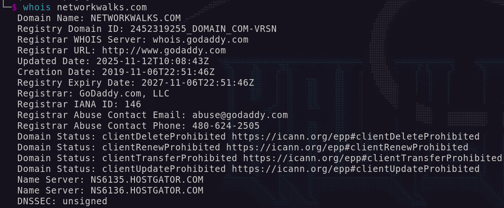
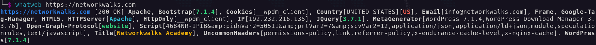
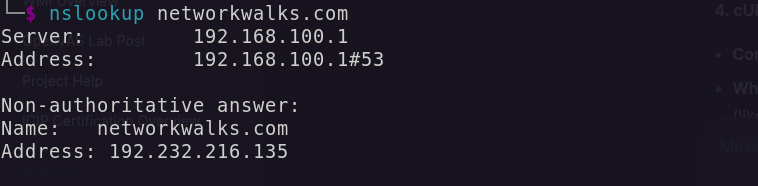
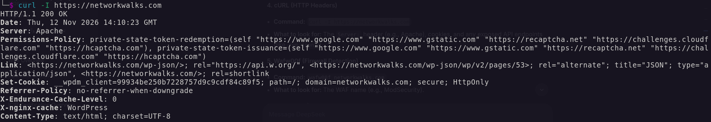
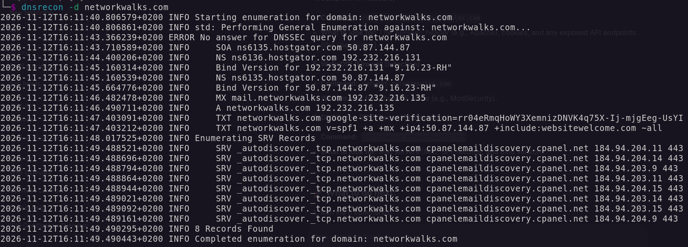
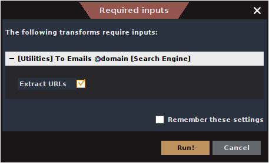
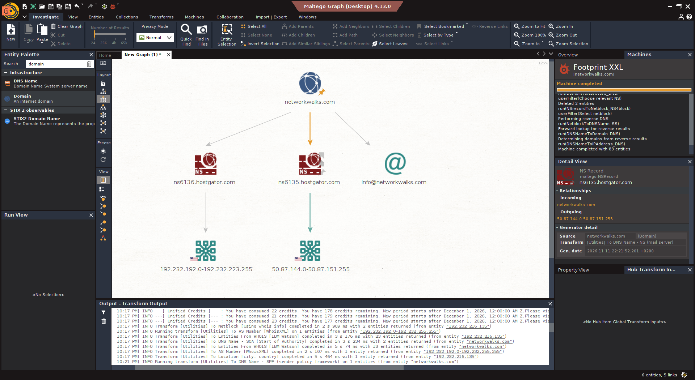
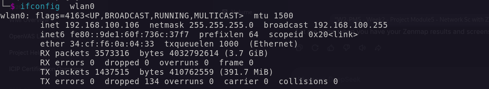
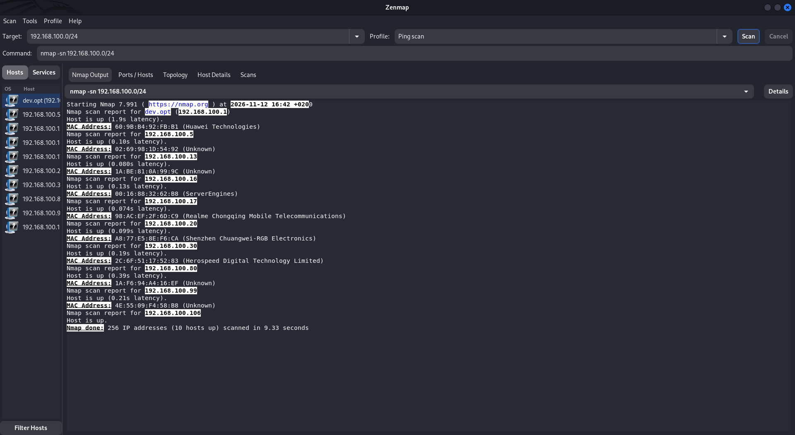
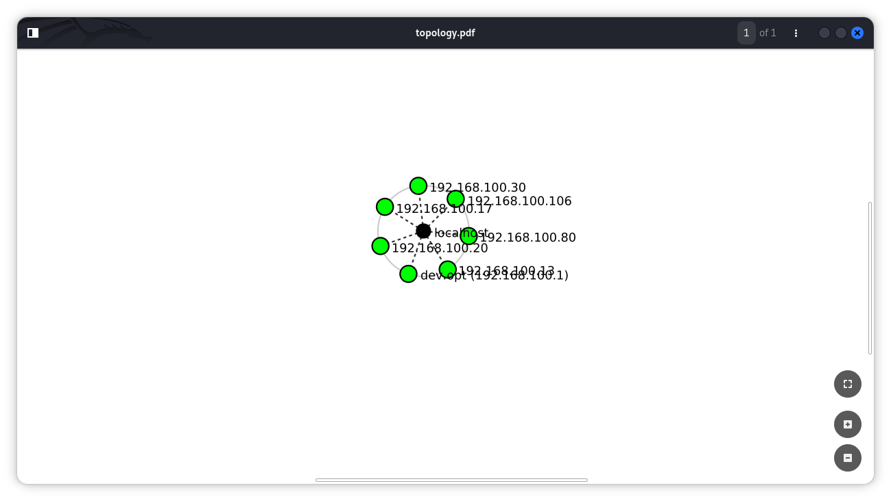

# 🕵️‍♂️ Networkwalks Week 2: Footprinting & Network Scanning

## 📄 Final Report
The complete penetration testing report for this project (including Risk Analysis and Recommendations) is available here:
👉 **[Download the Full Week 2 Report (PDF)](W2-ziadamin-FinalReport.pdf)**

---

## 📖 Overview
This repository contains my documentation, evidence, and findings for Week 2 of the Networkwalks Cybersecurity Internship (Batch B084). 

The objective of this project was to perform passive and active reconnaissance on a target domain (`networkwalks.com`), map its infrastructure using automated OSINT, and perform network discovery on a local subnet. 

All commands and tools were run exclusively on my **Kali Linux** machine.

## 🛠️ Tools Used
| Tool | Category | Purpose |
| :--- | :--- | :--- |
| **WHOIS** | Reconnaissance | Find domain registration details (registrar, dates, name servers). |
| **WhatWeb** | Reconnaissance | Fingerprint web technologies (server, CMS, plugins, IP). |
| **Nslookup** | Reconnaissance | Resolve the domain name to its IP address using DNS. |
| **cURL** | Reconnaissance | Read the HTTP response headers of the website. |
| **Wafw00f** | Reconnaissance | Detect whether a Web Application Firewall protects the site. |
| **DNSRecon** | Reconnaissance | Enumerate all DNS records (NS, MX, SPF, TXT, SRV). |
| **Maltego** | OSINT | Automated graph generation and infrastructure mapping. |
| **Zenmap** | Network Scanning | Scan the local subnet to find live hosts and MAC addresses. |

---

## 📂 Modules Completed

### 1. Manual Footprinting with Kali Tools (W2-PM1)
I performed manual reconnaissance against the `networkwalks.com` domain using six built-in Kali Linux tools.
*   **WHOIS:** Identified **GoDaddy** as the registrar. The domain was created on **November 6, 2019**, and points to HostGator name servers.
*   **WhatWeb:** Identified the target runs **Apache**, **WordPress 7.1.4**, and **WP Download Manager 3.76**. It exposed the server IP (`192.232.216.135`) and the public email `info@networkwalks.com`.
*   **Nslookup:** Resolved the domain to `192.232.216.135`.
*   **cURL:** Executed `curl -I https://networkwalks.com`. The headers exposed the WordPress REST API (`/wp-json/`), confirmed Apache, and showed an Nginx caching layer (`X-nginx-cache: WordPress`).
*   **Wafw00f:** Confirmed the site is protected by a **ModSecurity (SpiderLabs)** Web Application Firewall.
*   **DNSRecon:** Revealed the Bind version (`9.16.23-RH`), the Mail Server (`mail.networkwalks.com`), SPF records, and cPanel SRV auto-discovery records.

### 2. Automated OSINT with Maltego (W2-PM3)
To map the infrastructure visually, I used Maltego on Kali Linux.
*   Created a Domain entity for `networkwalks.com` and ran the **[Utilities] To Email Addresses [Search Engine]** transform, confirming the `info@networkwalks.com` address.
*   Executed the **Footprint XXL** automated machine. This expanded the graph to reveal the hosting infrastructure, identifying the HostGator Name Servers and mapping the target to specific IP netblocks (`192.232.x.x` and `50.87.x.x`).

### 3. Network Scanning with Zenmap (W2-PM5)
For the final activity, I used Zenmap on my Kali Linux machine to perform network discovery on my local network.
*   **Local IP:** My Kali machine is `192.168.100.106` (Subnet: `192.168.100.0/24`).
*   **Live Hosts:** Zenmap identified **10 live hosts** on the network, including the gateway router and various IoT devices.
*   **Topology:** Generated a network topology map and saved it as a PDF.

---

## 🖼️ Evidence Gallery

### PM1: Manual Footprinting
*   **WHOIS Output:** 
    
*   **WhatWeb Output:** 
    
*   **Nslookup Output:** 
    
*   **cURL Headers Output:** 
    
*   **Wafw00f Output:** 
    
*   **DNSRecon Output:** 
    

### PM3: Maltego Graph
*   **Email Harvesting Transform:** 
    
*   **Footprint XXL Infrastructure Map:** 
    

### PM5: Zenmap Network Scan
*   **Local IP Configuration (`ifconfig`):** 
    
*   **Zenmap Ping Scan Results:** 
    
*   **Zenmap Topology Map:** 
    

---
*Completed as part of the Networkwalks Cybersecurity Internship (Batch B084).*
